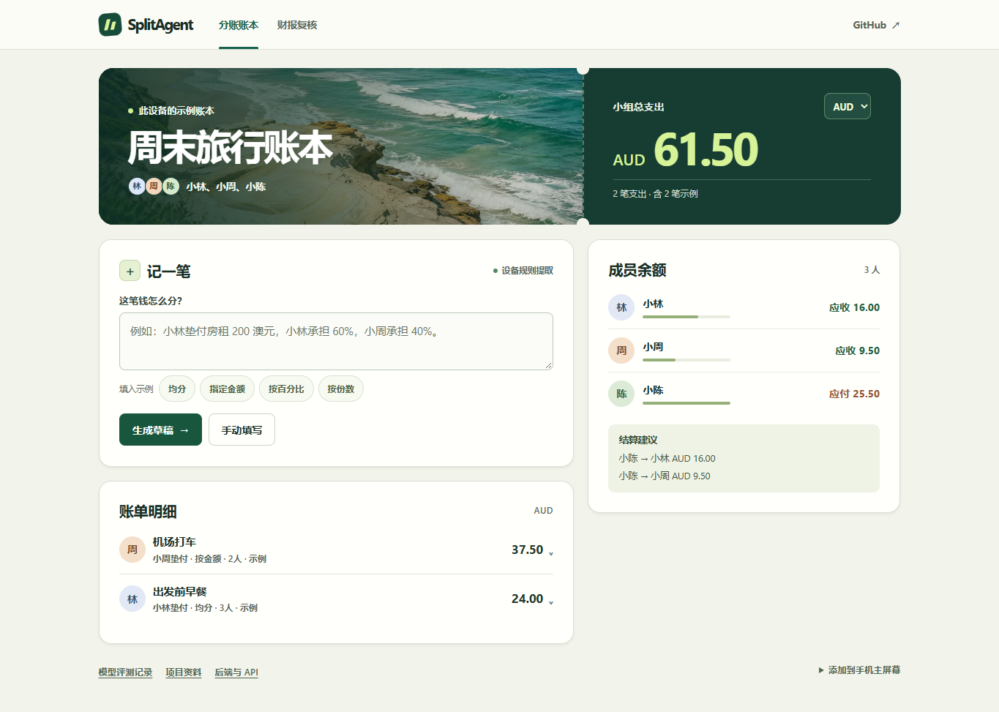
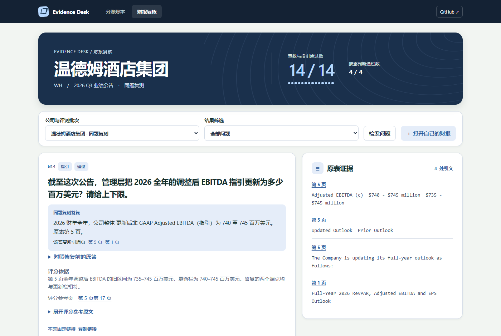

# 财报复核工作台 · Report Evidence Workbench

用中文查询英文财报，核对回答中的金额、期间、单位和出处。工作台会展示原始答复、PDF 物理页码与引文，方便检查某个数字取自哪一行。

Ask questions in Chinese against an English earnings release. Inspect a recorded answer and its source row offline, or upload your own report and run the reader locally with Ollama.

## 在手机或电脑上使用

[打开 SplitAgent 分账](https://shuboyu0520.github.io/report-evidence-workbench/splitagent.html) · [打开财报证据工作台](https://shuboyu0520.github.io/report-evidence-workbench/evidence-review.html)

- **分账**　用中文描述或手动录入一笔费用，选择均分、指定金额、百分比或按份数。比如“小陈垫了 100 元买食材，小林、小周、小陈按 2:1:1 分摊”，草稿会列出 50、25、25 元。核对后确认入账，再查看各人净余额和结算建议。公开示例含三位虚构成员，新账单按设备保存，AUD、CNY、USD 分开统计。
- **财报**　首页收录谷歌母公司 Alphabet、AMD、英伟达、Meta 和微软的季度公告。可查看集团与分部营收、现金流及官方原表。报告期按各公司财年标明。历史 Agent 评测可从同一菜单进入，保留冻结答复、判定和修复前后对照。「打开自己的财报」支持在设备上解析文本型 PDF 或 UTF-8 TXT，按关键词查找原页。公开版展示的模型答复来自已保存的运行记录。
- **手机**　两个页面可分别添加到主屏幕。在支持 Service Worker 的浏览器联网打开一次并完成缓存后，可离线使用两个工作台、账本和本地文件检索。外部公告链接需要网络。

五家公司的十道查数原题从 **4/10 提升至 10/10**。修复前为 4 对、1 错、5 拒答。复测使用相同文件与问题，逐题核对原始表行、期间、正负号和金额单位。[AMD 修复前后](https://shuboyu0520.github.io/report-evidence-workbench/evidence-review.html#cohort=amd&case=AMD01) · [六道失例分析及复现方法](evaluation/tech-reader-repair.md)

冻结后首次读取思科 FY2026 Q4 公告。**首测 1/8**，其中实际数值 0/5、下一季指引 0/1、披露判断 1/2。八道均返回证据不足，正确的一题是拒绝填报未单独披露的加拿大收入。该结果衡量对新公司表格的首次适应能力。[思科逐题盲测](https://shuboyu0520.github.io/report-evidence-workbench/evidence-review.html#cohort=cisco-first&case=C01) · [盲测前封存的八道题及评分标准](evaluation/cisco-tech-blind-preregistered.json)

[](https://shuboyu0520.github.io/report-evidence-workbench/splitagent.html)

分账交互参考 [Spliit](https://github.com/spliit-app/spliit) 与 [SplitPro](https://github.com/oss-apps/split-pro) 的分摊方式与余额展示。指定金额需凑齐总额，百分比需合计 100%。按权重分配时优先将尾分分给小数余数较大的成员，同余数按成员 ID 排序。财报交互参考 [RAGFlow](https://github.com/infiniflow/ragflow) 的引用溯源方式。设备上的 PDF 文本提取使用 [Mozilla PDF.js](https://github.com/mozilla/pdf.js)，随附 [Apache-2.0 许可证](docs/studio/vendor/PDFJS-LICENSE.txt)。

<a id="app-api"></a>
## 运行 Agent 后端

按下文安装 Python 依赖并配置 Ollama，运行 `uv run uvicorn app.main:create_app --factory --host 127.0.0.1 --port 8000`。从 [分账工作台](http://127.0.0.1:8000/studio/splitagent.html) 或 [财报工作台](http://127.0.0.1:8000/studio/evidence-review.html) 打开同一套界面。Web、原生客户端或脚本可以使用 [OpenAPI 文档](http://127.0.0.1:8000/docs) 中的 JSON 和上传接口。

| 操作 | API | 结果 |
| --- | --- | --- |
| 创建分账会话 | `POST /api/studio/session` | 客户端保存响应的会话 Cookie，各会话账本隔离 |
| 提取费用 | `POST /api/studio/drafts/parse` | 提交 `{"text":"小林付了 96 澳元买晚餐，三个人均摊。"}`。配置 Ollama 时返回模型字段和校验步骤 |
| 预览分摊 | `POST /api/studio/drafts/quote` | 输入核对后的字段，返回每位组员的整数分值 |
| 确认入账 | `POST /api/studio/entries` | 提交 `{id, data}`，一次草稿使用同一个 UUID。相同内容重试复用原记录，冲突返回 409 |
| 读取本会话的记录 | `GET /api/studio/entries` | 返回 SQLite 中持久化的账单。界面上的两笔固定示例不写入数据库 |
| 上传财报、提问 | `POST /reports` → `POST /reports/{id}/questions` | 表单上传后提交 `mode=reader` 的问题，返回答复、核验状态、引用页和实际工具调用 |

服务端分账面向这个三人示例小组。公开 Pages 使用设备规则提取自定义账单，固定评测输入可回放原模型输出。自托管服务将确认记录写入数据库；在财报面板显式提交时才向当前实例上传文件。原有独立分账项目用于账号、邀请和多人协作。

## 先看一道题 / Quick start

打开[温德姆案例](https://shuboyu0520.github.io/report-evidence-workbench/evidence-review.html#cohort=wyndham-replay&case=W14)，可以对照同一道题的两次答复，再到公告原页检查金额、期间和指引版本。下载仓库后，可用 `python -m http.server --directory docs 8080` 启动本地网页，或用 Python 3.10 以上版本在仓库目录运行以下命令。

```shell
python scripts/inspect_eval.py --cohort wyndham-replay --case W14
```

温德姆把 2026 年全年调整后 EBITDA 的指引下限提高了多少？公告第 5 页并排印着两组区间，旧版未能选出单元格。按更新栏读取，全年指引为 **740–745 百万美元**，此前为 **735–745 百万美元**。这两组数值共用上限，只检查上限无法识别取错栏。[温德姆原始公告](https://investor.wyndhamhotels.com/news-events/press-releases/detail/432/wyndham-hotels-resorts-reports-strong-third-quarter)

[](https://shuboyu0520.github.io/report-evidence-workbench/evidence-review.html#cohort=wyndham-replay&case=W14)

```shell
python scripts/inspect_eval.py
python scripts/inspect_eval.py --cohort hyatt --failed
```

第一条显示评测概况，第二条列出新公司首测的失败样例。[逐题存档 JSON](evaluation/showcase.json) · [已上线的台积电联读案例](https://shuboyu0520.github.io/report-evidence-workbench/reader.html) · [三分钟实录](https://shuboyu0520.github.io/report-evidence-workbench/library.html#demo)

## 冻结评测 / Evaluation results

| 场景 | 查数与指引 | 披露状态 |
| --- | ---: | ---: |
| Booking，原题修复后复测 | 14/14 | 4/4 |
| Expedia，新公司首次作答 | 2/14 | 4/4 |
| Expedia，同一 PDF 与题目修复后复测 | 14/14 | 4/4 |
| Hilton，上一轮冻结后首次作答 | 3/14 | 4/4 |
| Hilton，同一 PDF 与题目修复后复测 | 14/14 | 4/4 |
| Wyndham，上一轮冻结后首次作答 | 3/14 | 4/4 |
| Wyndham，同一 PDF 与题目修复后复测 | 14/14 | 4/4 |
| Hyatt，本轮冻结后首次作答 | 3/14 | 4/4 |

Booking 同一组 14 道查数与指引题依次通过 2、10、14 道。最后一次修复涉及单季自由现金流、调整后 EBITDA、报告口径间夜增幅和固定汇率总预订额增幅。

Expedia 首测的 12 道漏答中，11 道未选出合格原表单元格，1 道在最终校验时把会计括号负数读成正数。修复后复测通过 12/12 道实际值和 2/2 道指引。另以原 PDF 回放 Booking、Airbnb、Uber、高通、台积电的 76 道既有题，答复、引文和状态逐题一致。[12 道漏答的原因与原表](evaluation/expedia-failure-review.md) · [76 道回放记录](evaluation/expedia-repair-regression.json)

希尔顿首测有 3 道错答、8 道拒答。修复后，特许经营与授权费收入、自有酒店业务收入分别定位到 815 和 304 百万美元，利息费用定位到利润表的 −184 百万美元。另 8 道均通过原页核验。用前 6 家公司的 94 道题回放，答复、引文、页码与验证状态逐题一致。[希尔顿 11 道题的原因与结果](evaluation/hilton-failure-review.md) · [94 道历史回放](evaluation/hilton-repair-regression.json)

温德姆首测通过 **3/12 道实际值**，分别为 GAAP 摊薄每股收益 1.33 美元、集团净利润 99 百万美元、单季自由现金流 100 百万美元。**两道全年指引均未通过**。其余 11 道有原表答案的问题都停在原表取数阶段，系统没有选出符合条件的单元格，最终拒答。披露判断通过 4/4。[温德姆原始公告](https://investor.wyndhamhotels.com/news-events/press-releases/detail/432/wyndham-hotels-resorts-reports-strong-third-quarter) · [11 道拒答与原表](https://shuboyu0520.github.io/report-evidence-workbench/evidence-review.html#cohort=wyndham&filter=failed)

温德姆的 11 道漏答经原题复测全部通过，覆盖合并利润表、分部表、地区运营表及全年更新指引。另回放 7 家公司的 112 道历史题，答案、引文、页码及验证状态逐题一致。[逐题根因与结果](evaluation/wyndham-failure-review.md) · [112 道历史回归](evaluation/wyndham-repair-regression.json)

新公司首测只上传凯悦新闻室的 8 页官方公告。实际值答对 2/12，分别是新开客房 3,808 间和 A 类普通股回购 147 百万美元。全年指引答对 1/2，正确读出调整后 EBITDA 为 1,170–1,200 百万美元。披露判断通过 4/4。其余 11 道均拒答，其中 7 道未选出合格单元格，1 道未识别正文的同比期间，2 道将截至日期的月日当作待校验的数字，1 道因附加引文不连续而丢弃了正确的 RevPAR 区间。[凯悦原公告](https://newsroom.hyatt.com/Q3-2026-Earnings-Results) · [11 道拒答及原文](https://shuboyu0520.github.io/report-evidence-workbench/evidence-review.html#cohort=hyatt&filter=failed)

*Wyndham is a replay of the same questions. Hyatt was evaluated once on preregistered questions with the frozen reader and the eight-page newsroom release. Disclosure questions are scored separately.*

<a id="run-reader"></a>
## 上传自己的报告 / Run the reader

安装 Python 3.12–3.14、uv 和 Ollama。启动 Ollama 服务后，在仓库根目录打开 PowerShell。

```powershell
ollama pull qwen3:4b-instruct
ollama pull qwen3-embedding:0.6b
$env:OLLAMA_MODEL='qwen3:4b-instruct'
$env:OLLAMA_EMBED_MODEL='qwen3-embedding:0.6b'
uv sync --frozen
uv run uvicorn app.main:create_app --factory --host 127.0.0.1 --port 8000
```

打开[本机阅读器](http://127.0.0.1:8000/reader)，在「用自己的资料提问」中上传带文本层的 PDF 或 UTF-8 TXT，填写发布日期。选择主资料与研究截止日，提问后可查看原页引文、回答状态，并下载该次分析的输入与调用记录。

## 复现模型评测 / Reproduce a run

运行 `git rev-parse HEAD:app` 可查看应用目录的 Git 对象。模型摘要、推理参数、运行时间与历史回放数量见[本轮冻结记录](evaluation/wyndham-repair-release.json)。[上一轮冻结记录](evaluation/hilton-wyndham-release.json)保留了温德姆首测时的环境。

将[温德姆季度公告所附 PDF](https://investor.wyndhamhotels.com/news-events/press-releases/detail/432/wyndham-hotels-resorts-reports-strong-third-quarter)和[凯悦新闻室公告 PDF](https://newsroom.hyatt.com/Q3-2026-Earnings-Results?asPDF=1)分别保存为 `wyndham.pdf` 和 `hyatt.pdf`。保持 Ollama 运行，选择尚未存在的输出目录。

```shell
uv run python -m scripts.evaluate_reader --fixture evaluation/wyndham-reader-blind.json --file wyndham.pdf --out replay-wyndham
uv run python -m scripts.grade_wyndham_replay --fixture evaluation/wyndham-reader-blind.json --pdf wyndham.pdf --raw replay-wyndham/results.json --output replay-wyndham/graded.json
uv run python -m scripts.evaluate_reader --fixture evaluation/hyatt-reader-blind.json --file hyatt.pdf --out replay-hyatt
```

脚本核验 PDF 哈希，逐题调用上传与问答接口，并保存首次响应。复核时检查原表行列、符号、期间、单位和指引版本。[温德姆题集](evaluation/wyndham-reader-blind.json) · [凯悦题集](evaluation/hyatt-reader-blind.json) · [凯悦首测登记](evaluation/hyatt-preregistration.json)

## 贡献失败样例 / Contribute a case

欢迎提交可以复查的错答或漏答。请带上原始问题、研究截止日、发行人公开 PDF、物理页码和原答，说明判分依据。代码调整可附最小复现以及同题修复前后的结果。[贡献指南](CONTRIBUTING.md)
