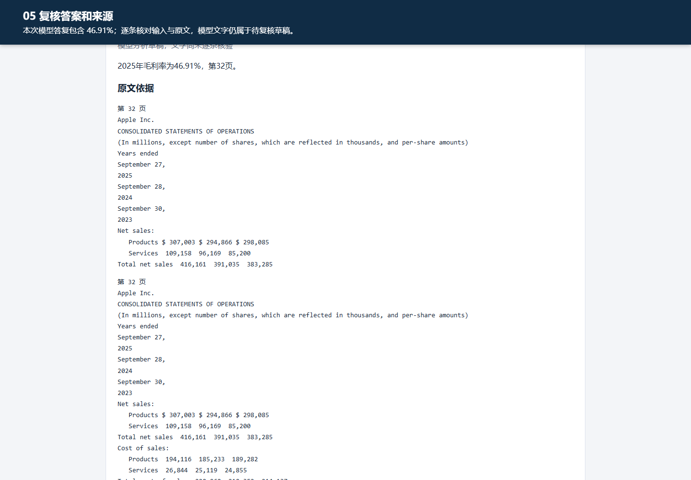

# 财报复核工作台

用年报原文复核一个财务数字。使用者可以定位证据、确认年度和单位，再由模型调用工具计算比率并导出依据。

[打开作品演示与逐题评测](https://shuboyu0520.github.io/report-evidence-workbench/) · [原表查数与独立验证](https://shuboyu0520.github.io/report-evidence-workbench/table-cases.html) · [观看三分钟实录](docs/demo.webm) · [一页项目案例](docs/case.pdf) · [36 道检索题](docs/retrieval.json) · [120 次模型运行](docs/model-runs.json) · [RAG 同题复测](docs/rag-replay.json)



## 一个例子

用中文询问苹果 2025 财年的研发费用。等权融合的前五个检索结果漏掉了目标证据，模型答复证据不足。改用真实嵌入模型进行语义检索后，第一条证据来自第 32 个物理页，包含 “Research and development  34,550  31,370  29,915”。核对列名和单位后，2025 财年的数值为 34,550 百万美元。[Apple 原始报告](https://s2.q4cdn.com/470004039/files/doc_financials/2025/ar/_10-K-2025-As-Filed.pdf)

## 检索与生成如何配合

- **直接查表**。财务表格检索对齐指标名称和数值行。在两份 Apple 年报的 20 道英文题上命中 20 道，在 Meta 年报的 10 道英文题上命中 9 道。
- **语义检索**。按 PDF 物理页切分带重叠的片段，保留原文和字符位置。SQLite 以文件摘要、模型摘要和分块版本缓存完整向量索引。中文查询英文报告优先使用余弦相似度，其他问题在 RAG 模式下使用 BM25 与向量的 RRF 融合。
- **计算与追溯**。Ollama 驱动 Qwen3 工具调用，服务端保留检索片段、计算输入和历史版本。读取财务比率时使用已确认的数值，Decimal 工具负责运算，缺数时说明原因。

| 前五条命中完整证据行 | 表格行检索 | BM25 | 纯向量 | 等权 RRF |
|---|---:|---:|---:|---:|
| Apple 英文，20 题 | 20 | 12 | 15 | 12 |
| Meta 英文，10 题 | 9 | 2 | 7 | 8 |
| 中文改写，6 题 | 0 | 0 | 4 | 1 |

中文改写沿用六条已有标注。三种通用方案（BM25、纯向量、RRF）使用相同的块，表格行检索使用专门的行窗口。模型 A/B 在一份年报、15 条预先确认的指标和 20 道固定开发题上运行三轮，末轮 A 通过 5 题，B2 通过 20 题。结果页面按轮列出失败原因。项目尚待目标用户试用。

## 本地运行

安装 Python 3.12 和 uv，在仓库根目录运行下列命令。在浏览器打开终端显示的地址，上传 `examples/demo-report.txt` 即可使用表格检索和计算。若只想浏览作品，直接打开 `docs/index.html`。

```console
uv sync --frozen
uv run uvicorn --factory app.main:create_app --host 127.0.0.1 --port 8146
```

要启用 Agent 和 RAG，启动 Ollama，依次准备两个模型，然后使用内置的 B2 提示词入口。

```console
ollama pull qwen3:4b-instruct
ollama pull qwen3-embedding:0.6b
uv run python -m scripts.serve_model_demo --url http://127.0.0.1:11434
```

## 复现评测

在仓库根目录运行。检索评测会从两个标注清单读取三份 PDF 的相对路径，并核对 SHA-256。先按 [Apple 清单](evaluation/retrieval_gold.json) 和 [Meta 清单](evaluation/retrieval_holdout_meta.json) 的 `source` 下载文件到对应的 `file` 路径。模型评测使用 Apple 2025 年报和仓库内的标注。真实模型运行时间取决于硬件，后续运行的回答可能有变化。

```console
uv run pytest -q
uv run python -m scripts.evaluate_hybrid --url http://127.0.0.1:11434 --out data/retrieval-run
uv run python -m scripts.evaluate_model_ab --url http://127.0.0.1:11434 --out data/model-run
```

从 [分块、向量和融合排序](app/retrieval.py)、[Agent 工具调用及回答检查](app/agent.py)、[财务口径和确定性计算](app/finance.py) 或 [逐题评测脚本](scripts/evaluate_hybrid.py) 阅读核心实现。

## Amazon 旧版盲测记录

首次通过 5/18，候选复测通过 5/18，当时版本的回归通过 5/18。14 道查数题和 4 道报告期间之外的缺数题采用预先冻结的原表物理页标注。候选检索策略没有通过比较，发布版保留原策略及新增的三类异常保护。9 项新增 API 故障注入测试计入全量 85 项。

[逐题对照与 SQL 复盘](https://shuboyu0520.github.io/report-evidence-workbench/holdout.html) · [冻结题集](evaluation/amazon_holdout.json) · [SQL](evaluation/failure_analysis.sql)

运行 `uv run python -m scripts.analyze_failures` 即可从公开数据重建 SQL 汇总。从标注的 source 下载年报，再运行 `uv run python -m scripts.evaluate_holdout --pdf data/amazon-2024.pdf --url http://127.0.0.1:11434 --out data/amazon-new-run`。输出目录必须为新目录，便于保留每次结果。

## 从原表定位金额

亚马逊原题的查数通过数从 1/14 提升到 14/14。Alphabet 首测 2/14，兼容不同表头后复测 11/14。最终冻结的问答逻辑在 Netflix 首次盲测中通过 10/14。三组的 4 道缺数题均满足拒答判据。模型只选择候选行，金额来自实际表头和原始单元格。Netflix 有 3 道地区收入附注题和 1 道合计题未通过。

[逐题记录](docs/table-audit.json) · [读取器](app/table_lookup.py) · [Alphabet 预标注](evaluation/alphabet_holdout.json) · [Netflix 预标注](evaluation/netflix_holdout.json)

下载对应标注的原件，可用 `uv run python -m scripts.evaluate_holdout --fixture evaluation/netflix_holdout.json --pdf data/netflix-2024.pdf --out data/netflix-new-run` 复测。96 项本地自动化回归通过。早期评测中的“发布版”指对应阶段的历史版本。

运行 `uv run python -m scripts.analyze_table_runs` 可从公开逐题数据重建六轮 [SQL 失败归因](docs/table-failures.json)。旧版 Amazon 有 10 题漏掉原行，3 题命中原行但金额错误。
